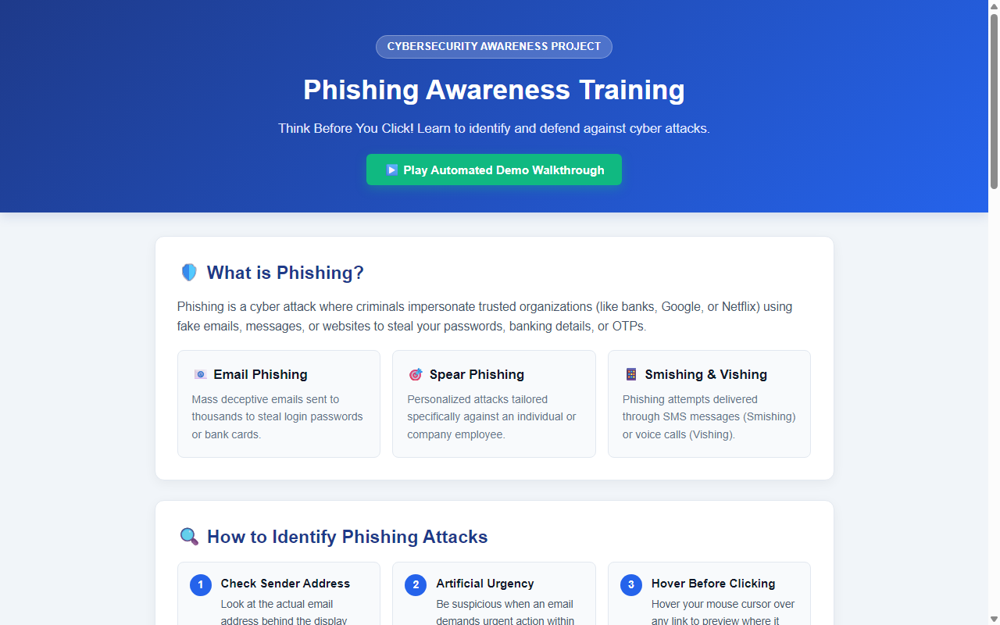
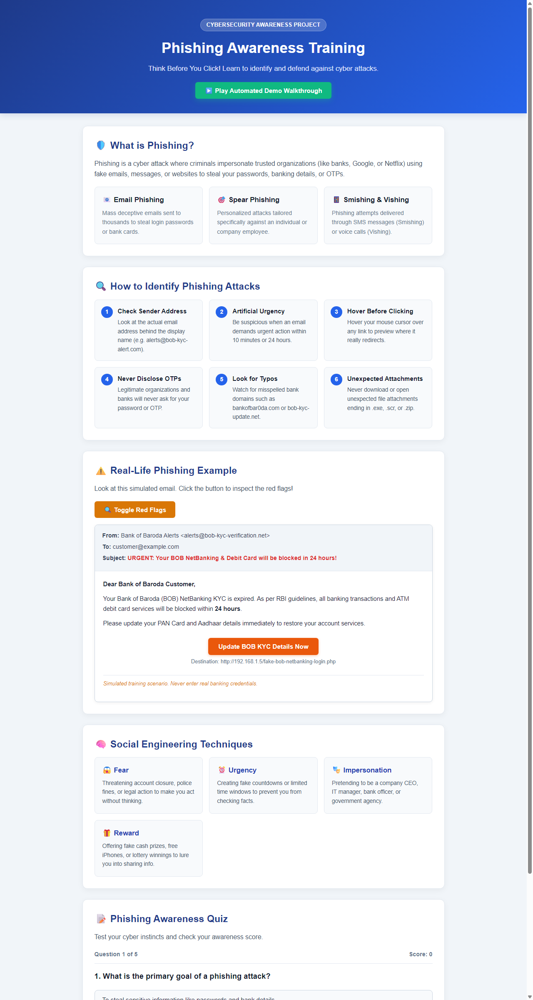

# Phishing Awareness Training

<p align="center">
  <strong>An interactive cybersecurity awareness website that helps users recognize phishing attempts and social engineering tactics.</strong>
</p>

<p align="center">
  
  
  
</p>

## Overview

**Phishing Awareness Training** is an educational web application developed as part of the **CodeAlpha Cyber Security Internship**. It demonstrates how phishing attacks and social engineering attempts work, and teaches users how to identify warning signs before interacting with suspicious messages or links.

The project combines practical examples, a phishing-email inspection activity, and a short knowledge quiz in a responsive browser-based experience.

## Key Features

- **Phishing education:** Introduces common techniques, including email phishing, spear phishing, smishing, and vishing.
- **Red-flag checklist:** Highlights practical warning signs such as suspicious links, unexpected attachments, urgent language, and requests for sensitive information.
- **Interactive email example:** Provides a simulated Bank of Baroda-themed phishing email with a control to reveal common warning signs. This is an educational mock-up, not a real bank communication.
- **Social engineering awareness:** Explains tactics such as urgency, fear, impersonation, and fake rewards.
- **Knowledge quiz:** Includes five questions with feedback, explanations, score tracking, and a restart option.
- **Demo support:** Includes an automated walkthrough and a browser-based screen recording option for creating a project demo.
- **Responsive interface:** Uses a clean light theme designed for desktop and mobile screens.

## Screenshots

| Project overview | Full-page preview |
|---|---|
|  |  |

## Technology Stack

| Technology | Purpose |
|---|---|
| HTML5 | Page structure and content |
| CSS3 | Styling, layout, and responsive design |
| JavaScript | Quiz logic, interactive email inspection, and demo interactions |

No backend or database is required. The application runs in a web browser.

## Getting Started

### Prerequisites

- A modern web browser
- Visual Studio Code (recommended)
- Live Server extension (optional)

### Run locally

1. Clone the repository:

   ```bash
   git clone https://github.com/ratanndeveloper-027/CodeAlpha_Tasks.git
   ```

2. Open the `Project-1-Phishing-Awareness` folder in Visual Studio Code.
3. Open `index.html` in your browser, or use the **Live Server** extension.

## Project Structure

```text
Project-1-Phishing-Awareness/
├── index.html       # Main application page
├── style.css        # Layout, styling, and responsive design
├── script.js        # Quiz and interactive learning features
├── screenshots/     # Project screenshots
└── README.md        # Project documentation
```

## Learning Outcomes

- Recognizing common phishing patterns and social engineering techniques.
- Checking suspicious links, sender details, and high-pressure messages before taking action.
- Building interactive and responsive web interfaces using HTML, CSS, and JavaScript.
- Communicating cybersecurity concepts through practical examples.

## Responsible Use

This project is intended for **cybersecurity education and awareness only**. The email example is simulated and should not be used to impersonate an organization, collect credentials, or deceive real users.

## Internship

- **Organization:** CodeAlpha
- **Domain:** Cyber Security
- **Project:** Phishing Awareness Training

---

<p align="center">Built as a hands-on cybersecurity learning project.</p>
