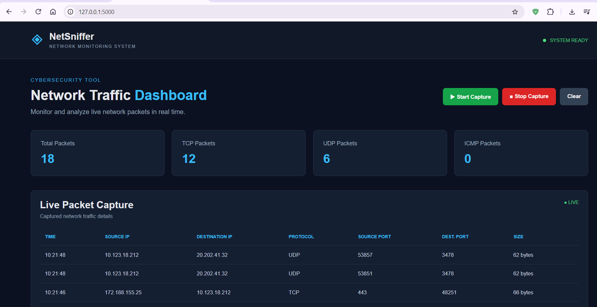
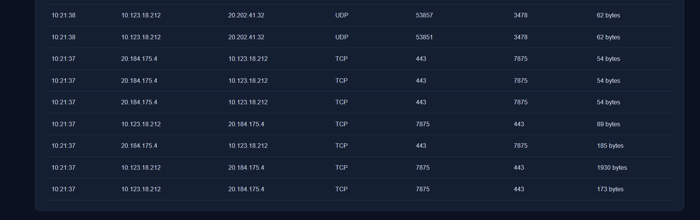

# NetSniffer | Basic Network Sniffer

<p align="center">
  <strong>A Python and Flask web application for observing live network packet metadata.</strong>
</p>

<p align="center">
  
  
  
  
</p>

## Overview

**NetSniffer** is a Python-based network monitoring project developed as part of the **CodeAlpha Cyber Security Internship**. It captures packets from an authorized network interface and presents selected packet metadata in a browser-based dashboard.

The project demonstrates the fundamentals of packet capture, protocol identification, and real-time monitoring using Scapy, Npcap, and Flask.

## Key Features

- **Live packet capture:** Observes packets on the selected/default capture interface.
- **IP information:** Displays source and destination IP addresses.
- **Protocol identification:** Identifies common IP protocols such as TCP, UDP, and ICMP.
- **Port information:** Displays source and destination ports when available.
- **Packet details:** Shows packet size and captured traffic entries.
- **Web dashboard:** Presents captured packet information in a browser.
- **Capture controls:** Start, stop, and clear packet data from the interface.

## Screenshots

Add a quick visual reference to the dashboard and captured traffic:

| Dashboard | Live packet capture | TCP/UDP traffic |
|---|---|---|
|  |  |  |

## Technology Stack

| Technology | Purpose |
|---|---|
| Python | Application logic |
| Scapy | Packet capture and packet inspection |
| Npcap | Packet-capture support on Windows |
| Flask | Web server and API endpoints |
| HTML5 | Dashboard structure |
| CSS3 | Dashboard styling |
| JavaScript | Dashboard updates and user controls |

## Architecture

1. **Capture layer:** Scapy listens for packets through the available network-capture interface.
2. **Processing layer:** The application extracts useful metadata, including IP addresses, protocol, and packet size.
3. **Backend layer:** Flask exposes endpoints used by the dashboard to control capture and retrieve packet data.
4. **Presentation layer:** HTML, CSS, and JavaScript display the captured packet information in the browser.

## Getting Started

### Prerequisites

- Windows 10/11
- Python 3
- Npcap installed on Windows
- Administrator privileges may be required for packet capture
- A modern web browser

### 1. Clone the repository

```bash
git clone https://github.com/ratanndeveloper-027/CodeAlpha_Tasks.git
```

### 2. Open the project folder

```bash
cd CodeAlpha_Tasks/Project-2-Network-Sniffer
```

### 3. Create and activate a virtual environment

**Command Prompt:**

```cmd
python -m venv venv
venv\Scripts\activate
```

### 4. Install dependencies

```bash
python -m pip install -r requirements.txt
```

If you do not have Npcap installed, install it from the [official Npcap website](https://npcap.com/). Follow its installation instructions for your Windows system.

### 5. Run the application

Open Command Prompt as Administrator if packet capture requires elevated permissions, navigate to the project folder, activate the virtual environment, and run:

```bash
python app.py
```

### 6. Open the dashboard

Visit:

```text
http://127.0.0.1:5000
```

Use the dashboard controls to start and stop packet capture and clear the displayed packet list.

## Project Structure

```text
Project-2-Network-Sniffer/
├── app.py              # Flask application and dashboard API
├── sniffer.py          # Packet-sniffing functionality
├── requirements.txt    # Python dependencies
├── templates/
│   └── index.html      # Dashboard page
├── static/
│   ├── style.css       # Dashboard styles
│   └── script.js       # Frontend interactions and updates
├── screenshots/        # Application screenshots
└── README.md           # Project documentation
```

## Learning Outcomes

- Understanding packet capture and basic packet inspection.
- Learning how Scapy and Npcap support network monitoring on Windows.
- Identifying common protocols and reading source/destination network information.
- Connecting a Python backend to a browser-based dashboard using Flask APIs.
- Understanding why packet capture should be performed only with proper authorization.

## Security and Privacy Notice

Use this tool **only on networks and devices you own or have explicit permission to monitor**. Captured traffic may contain sensitive information. This project is intended for learning and authorized troubleshooting, not covert monitoring or unauthorized interception.

## Internship

- **Organization:** CodeAlpha
- **Domain:** Cyber Security
- **Project:** Basic Network Sniffer

---

<p align="center">Built as a hands-on network security learning project.</p>
